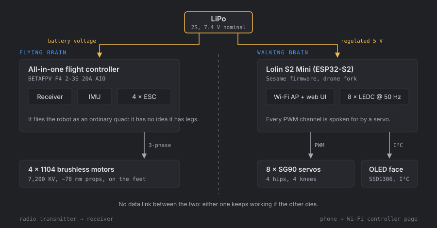
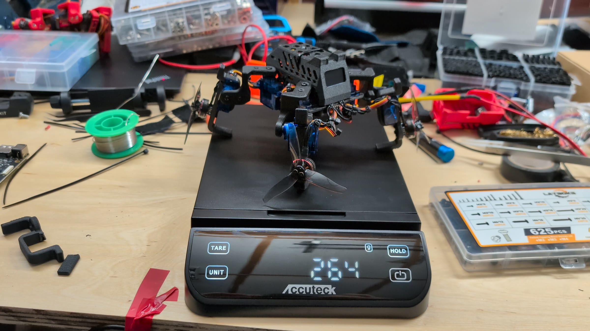
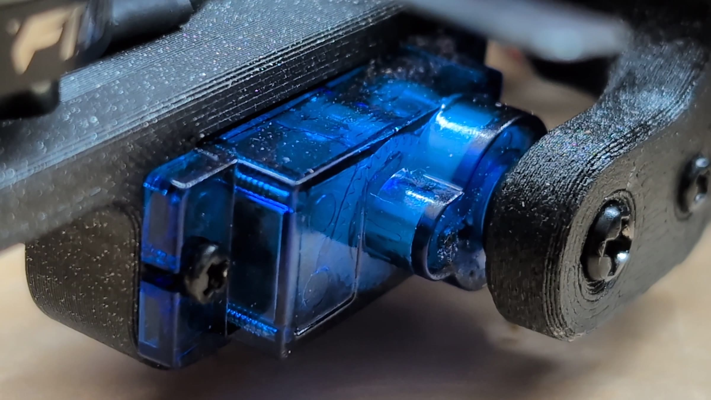
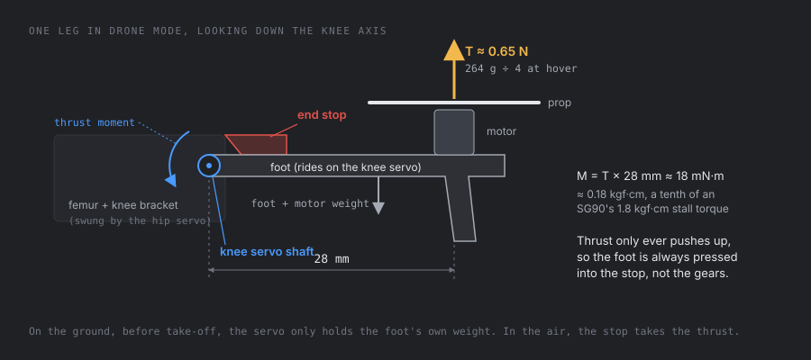
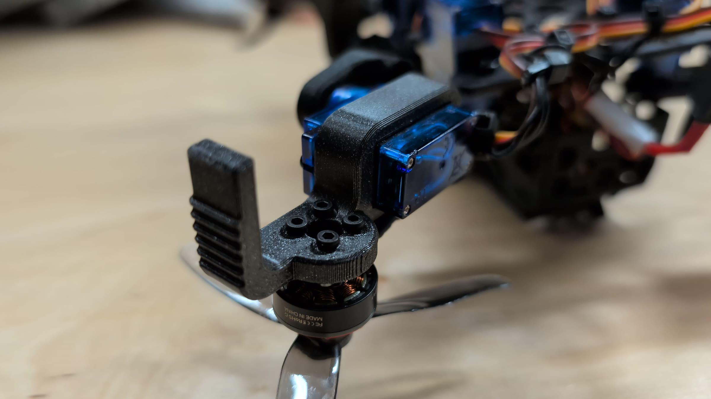
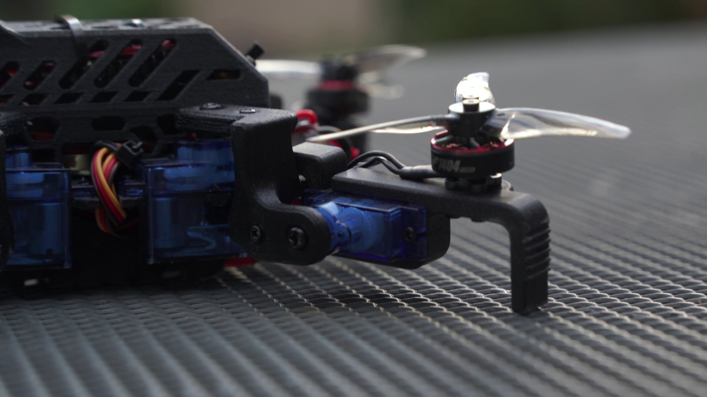
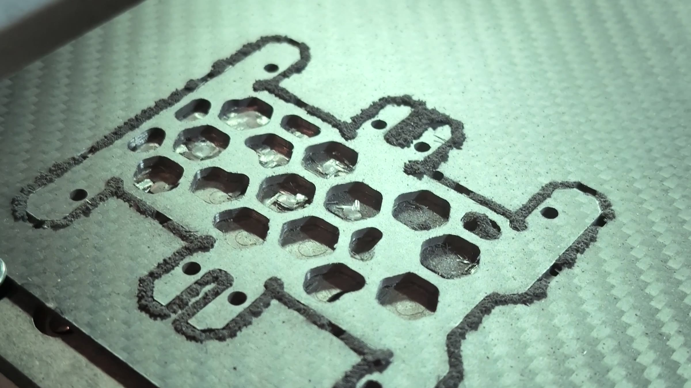
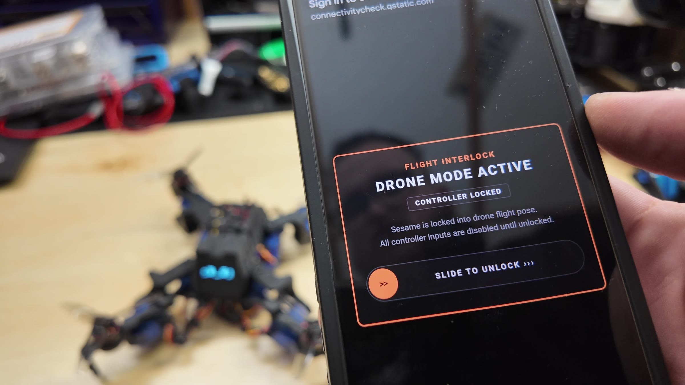

Sesame Drone walks somewhere on its legs, folds them out flat into propeller arms, takes off, lands, and walks away again. It's built on [Sesame](/sesame), my open source quadruped. There's a video about the build that tells the story; this page is the engineering side of it: the numbers, the mechanism, the firmware, and what I'd change.


The model at the top of the page is the real Fusion 360 assembly, rigged on the actual servo shafts. You can drive it through the same sequence or pose it by hand, and its thrust arrows show the one idea this whole design hangs on. The last section explains how it was built.

## Specs

| | |
|---|---|
| Flying weight | 264 g (target 250 g) |
| Legs | 4, each with a hip servo (swing) and a knee servo (fold) |
| Servos | 8 × SG90, 9 g, plastic gears |
| Motors | 4 × 1104 brushless, 7,200 KV, mounted on the feet |
| Props | about 78 mm (3 in) in the CAD |
| Motor layout | 156 × 127 mm rectangle, 201 mm diagonal |
| Span in drone mode | 223 × 175 mm over the props |
| Flight controller | BETAFPV F4 2-3S 20A AIO: receiver, IMU and four ESCs on one board |
| Walking controller | Lolin S2 Mini (ESP32-S2), a fork of the Sesame firmware |
| Battery | 2S LiPo, 7.4 V nominal |
| Face | 128 × 64 SSD1306 OLED on I²C |
| Frame | PPA-CF printed parts on a CNC cut carbon fiber plate |

## Two brains, no link between them



The robot is two machines sharing a battery. An all-in-one flight controller flies it as an ordinary quad and has no idea it has legs. A Lolin S2 Mini runs the eight servos, the OLED face and the Wi-Fi controller page, exactly like a regular Sesame. Nothing connects them, on purpose: if the flight side browns out, the robot can still walk, and if the ESP32 crashes mid-flight, the flight controller doesn't notice.

An all-in-one board was the only realistic choice for the flying side. It puts the radio receiver, the IMU that measures tilt, and the four ESCs that drive the motors on one small board, which saves the space and weight of four separate ESCs and the wiring between them. There isn't room for much else inside a Sesame body.

It also turns out the ESP32 couldn't run the motors anyway. The walking firmware drives the servos with the ESP32-S2's LEDC peripheral at 50 Hz:

```cpp
// firmware.ino: servo PWM setup
ESP32PWM::allocateTimer(0);
ESP32PWM::allocateTimer(1);
ESP32PWM::allocateTimer(2);
ESP32PWM::allocateTimer(3);

for (int i = 0; i < 8; i++) {
  servos[i].setPeriodHertz(50);
  servos[i].attach(servoPins[i], 732, 2929);  // 0 to 180 degrees, in microseconds
}
```

The S2 has eight LEDC channels and all eight are servos. I tried adding ESC outputs to this firmware early on, and it ran out of hardware timers and took the Wi-Fi captive portal down with it. A second, dedicated controller was cleaner than fighting that.

## The weight budget

I set the target at 250 grams for two reasons. Under that, standard toothpick drone parts work: tiny brushless motors and small LiPos that are cheap and easy to find. And 250 g is the line where a recreational drone has to be registered with the FAA in the US.

It came in at 264 g.



Fourteen grams sounds like nothing, but with fixed props, hover power scales with weight to the 1.5 power (more on why below):

$$
\frac{P_{264}}{P_{250}} = \left(\frac{264}{250}\right)^{1.5} \approx 1.085
$$

So those 14 grams cost about 8.5% more power just to hover, out of a margin that was thin to begin with.

The biggest single line item is the servos. The original Sesame uses MG90S servos: strong, metal gears, about 13 g each. RC planes use a lighter cousin, the SG90: 9 g, plastic gears. Swapping all eight saves about 35 g:

| | Mass |
|---|---|
| 8 × SG90 servos | 72 g |
| Everything else: motors, props, battery, both controllers, frame, wiring | 192 g |
| **Flying weight, measured** | **264 g** |
| Same robot with 8 × MG90S | about 299 g: $$(299/264)^{1.5} \approx 1.2$$, so **20% more hover power** |

The catch is that plastic gears strip, especially in a crash. I took that trade: even with stripped gears it's still a walking Sesame, and the end stops (below) mean the gears never carry the flight load.



## Small props have to spin very fast

For a propeller, static thrust goes roughly as

$$
T = C_T\,\rho\,n^2 D^4
$$

where $$n$$ is the rotation rate and $$D$$ the diameter. Halve the prop and you get a sixteenth of the thrust at the same speed, so it has to spin four times as fast to make it back. That's why micro drone motors have such high KV ratings. These are 7,200 KV: on a 2S pack at 7.4 V that's 7,200 × 7.4 ≈ 53,000 RPM unloaded.

You can also get a feel for the hover power from momentum theory. Each motor carries a quarter of the weight, $$T = 0.264 \times 9.81 / 4 \approx 0.65$$ N, through a disk of area $$A = \pi (0.039)^2 \approx 4.7 \times 10^{-3}$$ m². The ideal power is

$$
P = \frac{T^{3/2}}{\sqrt{2 \rho A}} \approx \frac{0.65^{1.5}}{\sqrt{2 \times 1.225 \times 0.0047}} \approx 4.8 \text{ W per motor}
$$

or about 19 W for all four. Real small props manage a figure of merit around 0.4 to 0.6, and the motors and ESCs lose some more, so a realistic estimate is somewhere around 45 to 70 W from the battery: roughly 6 to 9 A from a 2S pack, just to hover. This is also where the $$W^{1.5}$$ scaling above comes from.

### Why a thin margin is hard to fly

A flight controller corrects a tilt by speeding up the motors on the low side and slowing the ones on the high side. With a racing quad's eight to one thrust-to-weight ratio there's plenty of headroom for that. My target was only a little above one to one, so at hover the motors are already near full power. When the low side can't go any faster, the only way left to level out is to slow the high side, and the drone loses height while it corrects. That's the wobbly, sinking hover you see in the testing footage.

## Legs into propeller arms

Each leg has two servos. The firmware names them R1, R2, L1 and L2 for the hips and R3, R4, L3 and L4 for the knees. Standing puts the knees at 0 or 180 degrees, which points the feet straight down. Drone mode is the same stand with all four knees driven to 90, their midpoint, which folds each foot out flat:

```cpp
// movement-sequences.h
inline void runStandPose(int face) {
  setServoAngle(R1, 135); setServoAngle(R2, 45);   // hips
  setServoAngle(L1, 45);  setServoAngle(L2, 135);
  setServoAngle(R4, 0);   setServoAngle(R3, 180);  // knees: feet straight down
  setServoAngle(L3, 0);   setServoAngle(L4, 180);
  // ...
}

inline void runDronePose() {
  runStandPose(0);
  setFaceWithMode("drone", FACE_ANIM_BOOMERANG);
  delayWithFace(200);
  setServoAngle(R3, 90); setServoAngle(R4, 90);    // fold every foot out flat
  setServoAngle(L3, 90); setServoAngle(L4, 90);
}
```

Each foot carries its own knee servo (the horn is screwed to the femur), a motor and a prop. The knee axes are level and sit at 45 degrees across each corner of the body, so a 90 degree fold swings the foot from pointing at the ground to sticking straight out with the motor on top. Some numbers from the CAD:

| | |
|---|---|
| Knee axis to the ground when walking | 47 mm |
| Belly clearance when walking | 31 mm |
| Knee axis to the motor axis, in drone mode | 28 mm out, 12.5 mm up |
| Hip axis to the motor axis | 66 mm |
| Body centre to each motor | 100 mm |

## End stops: stiffness, not strength

This is the core problem with a walking robot turning into a drone. A drone's arms need to be as rigid as possible, because the flight controller assumes every motor stays exactly where it thinks it is. A walking robot's legs are the opposite: they're supposed to move all the time.

You might expect the problem to be servo strength. The numbers say otherwise. At hover each motor pushes up with about 0.65 N, 28 mm from the knee axis:

$$
M = 0.65 \text{ N} \times 0.028 \text{ m} \approx 18 \text{ mN·m} \approx 0.18 \text{ kgf·cm}
$$

An SG90 is rated at about 1.8 kgf·cm stall torque, so that's a tenth of what it can do. Strength isn't the problem. Stiffness is:

- **Dead band.** The firmware maps 0 to 180 degrees onto 732 to 2929 µs, so one degree is about 12 µs of pulse. The SG90's datasheet dead band is 10 µs, so the servo doesn't even try to correct an error smaller than about 0.8 degrees.
- **Backlash.** On top of that, plastic gears have play.
- **Bandwidth.** The servo gets a new position every 20 ms (50 Hz). The props turn hundreds of times a second. Anything the servo does about vibration is far too slow.

A drooping arm tilts its thrust. Every degree of tilt turns about 1.7% of that motor's thrust ($$\sin 1° \approx 0.017$$) into a sideways push, and the controller has to fight it, which shows up as wobble.

The fix is an end stop on every leg. In drone mode the foot folds out to exactly 90 degrees and lands against a printed stop on the femur. Here's the trick that makes it work: thrust only ever pushes up. So the load always presses the foot into the stop, and a stop that only works in one direction is enough to hold it rigidly. The servo's job shrinks to putting the foot there and holding its own weight while it sits on the ground.



On the robot, the stop is a small printed tab above each knee servo, and the whole switch from walking to drone mode takes a fraction of a second:




The hips are a different story, and I expected them to be a problem. They aren't locked in drone mode, so they wander a little. But the hip axis is vertical: a hip swing moves the motor around in the horizontal plane and the thrust still points straight up. Five degrees of hip wobble moves a motor $$0.066 \times 0.087 \approx 5.7$$ mm on a 100 mm arm. That changes the lever arms the mixer assumes by a few percent, which the PID loop absorbs without noticing. Testing backed this up: after a crash bent one leg out of place, the layout wasn't symmetric anymore and it still hovered fine.

Both effects are in the model at the top: lower the leg fold below 90 degrees with some throttle and the arrows tilt and turn red, swing the hips instead and they stay straight up.

## Printing it: walls, infill and hex holes

To save weight I trimmed the purely cosmetic details off the original Sesame and carved hexagon holes into the body. Then I found out that holes don't always save weight.

A printed part is a thin solid wall around a sparse infill lattice. When you cut a hole, the slicer wraps it in a new wall. For a round hole of radius $$r$$ in a region with infill fraction $$f$$ and wall thickness $$w$$:

- infill removed: $$f \cdot \pi (r + w)^2$$
- wall added: $$\pi\left((r + w)^2 - r^2\right) = \pi (2 r w + w^2)$$

The hole adds plastic whenever the second is bigger. With two 0.45 mm perimeters ($$w = 0.9$$ mm) and 15% infill, that's true for any hole under about 21 mm across. Try it on one layer of a printed bar:

<div class="widget" data-widget="infill-holes"></div>

The walls are also where the stiffness is. Bending stiffness goes with the second moment of area, $$I = \int y^2\, dA$$, so material far from the neutral axis does most of the work. That's why an I-beam is shaped like an I. The rule I ended up with: low infill on the thick parts, and save the hex holes for the thin shells, where the part is all wall anyway and a hole only removes plastic. On Sesame Drone the body shell is exactly that kind of part.

### PPA-CF

Everything is printed in PPA-CF: a high temperature nylon full of chopped carbon fiber. The spool calls for a 300 to 320 °C nozzle, and the fiber is abrasive enough to chew through brass, so it needs a hardened nozzle. In exchange it's extremely stiff, much closer to a metal part than to PLA in the hand. The trade-off is brittleness: it would rather crack than bend. You usually only get that stiffness from something like PEEK, and PPA-CF gets surprisingly close on a regular printer. It took a couple of rounds of reprints, mostly because the first motor mounts were simply the wrong size and had to be redesigned.



## The carbon fiber plate

The structure everything bolts to is a carbon fiber plate, cut from sheet with hex pockets to take the weight out. A printed plate would flex, and a flexy frame means more vibration reaching the IMU and a twitchier flight.

> [!SPONSOR] makera
> This build was sponsored by Makera. Their desktop CNC, the Makera Z1, cut the carbon fiber plate. It's fully enclosed, measures the stock and levels itself, has quick tool changes, and Makera Studio handles both the toolpaths and the machine control, so I went straight from the Fusion model to cutting. Carving carbon fiber gives parts that are stiffer and cleaner than anything I can print, which is exactly what a drone frame wants.
>
> 



## Firmware changes for flight

The walking side runs a fork of the Sesame firmware. Most of it is unchanged; the changes are about not destroying the robot.

**Culled emotes.** Several of Sesame's emotes swing a foot up past its midpoint, which in drone mode means straight through a prop or into the frame. Those are gone:

```cpp
// Note: Emotes that moved R4, R3, L3, or L4 above midpoint (>90 deg for L3/R4,
// <90 deg for R3/L4) have been culled for Sesame Drone flight clearance:
// wave, dance, point, cute, freaky, worm, shrug.
```

**A smoother trot.** The walk is a trot: diagonal pairs (R1 with L2, L1 with R2) swing forward while the other pair pushes, four keyframes at 100 ms each, with a slightly longer stride on the front legs:

```cpp
// movement-sequences.h, runWalkPose()
while (currentCommand == "forward") {
  // A swings forward while grounded B pushes the body forward
  setServoAngle(R1, 170); setServoAngle(L2, 106);
  setServoAngle(L1, 78);  setServoAngle(R2, 18);
  if (!pressingCheck("forward", frameDelay)) return;

  // A lands while B lifts
  setServoAngle(R3, 171); setServoAngle(L4, 176);
  setServoAngle(L3, 38);  setServoAngle(R4, 42);
  if (!pressingCheck("forward", frameDelay)) return;

  // B swings forward while grounded A pushes, then B lands while A lifts
  // ...
}
```

**Staggered servo writes.** Eight servos starting at once is a big current spike on the 5 V rail. Every write waits `motorCurrentDelay` (20 ms by default, adjustable from the web settings) before the next one:

```cpp
void setServoAngle(uint8_t channel, int angle) {
  if (channel < 8) {
    int adjustedAngle = constrain(angle + servoSubtrim[channel], 0, 180);
    servos[channel].write(adjustedAngle);
    delayWithFace(motorCurrentDelay);
  }
}
```

**A flight interlock in the controller page.** Drone mode puts the robot in the drone pose and covers the whole controller with a lock screen. Every input is blocked until you slide to unlock, so a stray thumb can't unfold a leg mid-flight:

```js
function canSendCommand() {
  return !isDroneMode && commandQueue < MAX_COMMANDS;
}

function enterDroneMode() {
  if (isDroneMode) return;
  isDroneMode = true;
  fetch('/cmd?pose=drone');
  document.getElementById('droneLockOverlay').style.display = 'flex';
}
```



One honest caveat: that lock lives in the controller page. The ESP32 itself will still accept a command from anything that sends one. Moving the interlock into the firmware is the first thing on my list below.

## How the 3D model on this page works

The model comes from a Fusion 360 export: 97 parts and 74 joints as OBJ files, 467 MB in total. A small converter script on this site drops the screws, removes the duplicate bodies the export flattens into the root component, simplifies every part, and writes a 273 KB compressed glTF with progressive detail levels.

The export's joint data turned out to be unusable (the joint origins come out in mixed coordinate frames), so the pivots are derived from the servos instead. Every SG90 in the assembly is the same vendor part, and in that part's own frame the output shaft sits at $$(-5.18, y, 0)$$ mm and points along $$+y$$. Running that through each servo's world transform from the export gives the real shaft positions:

```ts
// shaft = M · (-5.18 mm, 0, 0), axis = M · (0, 1, 0), M = the servo's world transform
{ id: 'FL', hip: mm(1.49, 16.82, -23.02), knee: mm(-30.07, 15.42, -43.47),
  kneeAxis: new THREE.Vector3(D, 0, -D), motor: mm(-52.26, 27.92, -60.93) },
```

The hip axes come out vertical and the knee axes come out level at exactly 45 degrees, which is a good sign the method is right. In the widget, each foot group turns about its knee axis, the props spin about the motor axes, the robot stands on the lowest point of whatever pose it's in, and the thrust arrows measure their tilt against the body's own up vector. The same rig runs this project's square on the home page.

## Test results

| Test | What happened |
|---|---|
| Prototype one | Flew briefly, then crashed. Enough to prove the concept. |
| Version two, garage | A few crashes on the rubber floor, then a low, wobbly hover. |
| Version two, backyard | Walked, switched to drone mode, took off, landed hard and broke a leg, then unfolded and walked away. |
| Later backyard flights | Hovered with the legs no longer symmetric, survived crashes under furniture and into bushes, and the last flight landed at my feet. |


The goal was walk, take off, land, walk again, and it did that. It's a fully flying quadruped: you can go from flying to walking just by landing somewhere.

## What I'd change next

- **Interlock in firmware.** The ESP32 should refuse leg moves in drone mode, not just the controller page.
- **Let the brains talk, a little.** One signal from the flight controller saying "armed" would let the walking side lock the legs automatically. Keeping it to one wire keeps most of the fault isolation.
- **More thrust margin.** Everything about the flight comes back to being only a little above one to one. More thrust per gram, or less mass, would make it fly like a drone instead of hovering like a hopeful one.
- **A proper board.** This build uses the hand-wired harness from a regular Sesame. The Sesame Distro Board V3.2 is in production, and a version laid out for the drone would clean up the inside a lot.

## Build your own Sesame

Sesame is 100% open source: the CAD, STLs, firmware and build guides are on [GitHub](https://github.com/dorianborian/sesame-robot), and the [Sesame page](/sesame) covers building the walking version. [Build kits](/sesame/kit) come back when a production round opens. If you try to make yours fly, come show it off on [Discord](https://discord.gg/XDXkhQd8bC).
