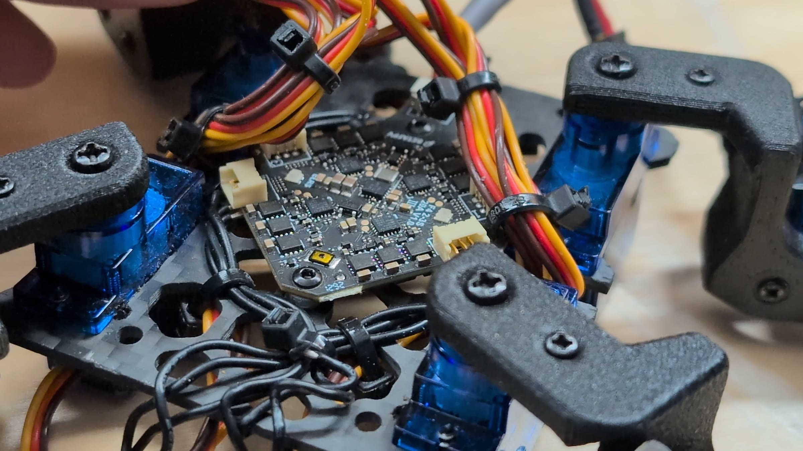
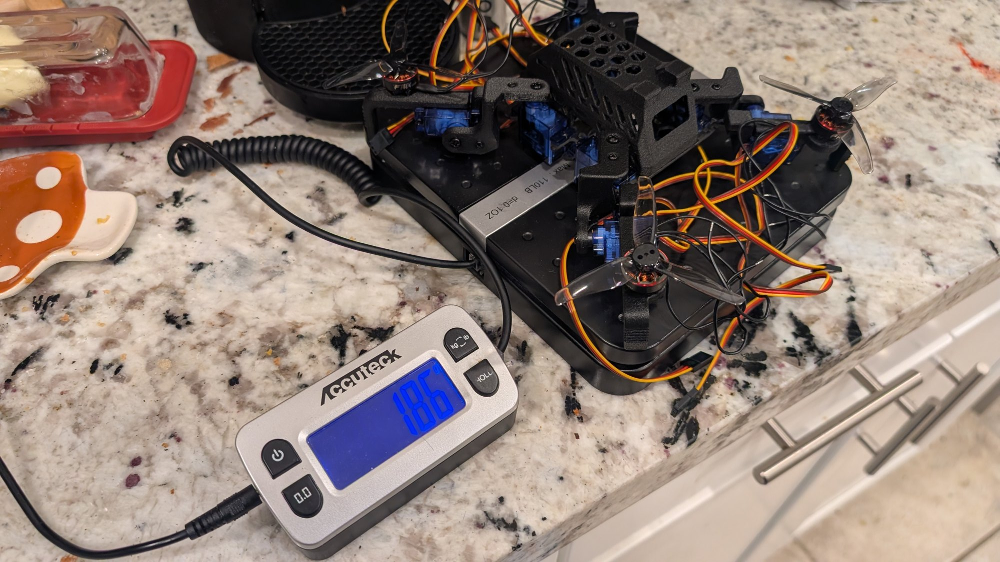

I've had this crazy idea for a while now: turn my tiny walking robot into a drone. And honestly, I didn't think it was even possible. That is, until I started testing it.

Sesame Drone is a [Sesame](/sesame) that flies. It walks around on its legs like any other Sesame, then folds those legs out flat until they turn into propeller arms, takes off, lands somewhere else, and walks away again. Four tiny brushless motors ride on the feet, an all-in-one flight controller flies it, and an ESP32 still runs the legs and the face. The whole thing weighs 264 grams.

The model at the top of this page is the real CAD, rigged with the actual servo shafts. Hit Walk, Drone mode or Take off, or grab the sliders and pose it yourself. Keep it in mind, because it'll make the part about end stops a lot more fun.

## The one rule of drones

If I wanted this thing to fly, I still had to follow the laws of physics, and for drones the big rule is simple: the props have to push down with more force than the robot weighs. That's called the thrust-to-weight ratio.

A racing drone makes something like eight times its own weight in thrust. A camera drone, maybe two or three times. That extra margin isn't just for going fast. It's what lets the flight controller catch itself: every time the drone tips, it needs spare thrust on one side to push itself back level.

My goal was way less ambitious. Get right around a 1:1 thrust-to-weight ratio, just enough to lift itself and kind of hover in the air. That leaves almost no spare thrust for corrections. Try it below: push the racing quad and it snaps back, push something right around 1 and watch where the correction comes from.

Hold that thought, it's going to matter later.

### Tiny props have it extra hard

Thrust grows with prop size to the fourth power, so a prop half the size makes a sixteenth of the thrust at the same speed. To keep up it has to spin four times as fast. These little motors are rated at 7,200 RPM per volt, and on a two-cell battery that's over 50,000 RPM.

## How much drone fits inside a Sesame?

I did a lot of research on motors, flight controllers and batteries, and the number I kept coming back to was 250 grams. Under that, I could use standard toothpick drone parts: tiny motors and batteries that are cheap and easy to get. Fun fact: 250 grams is also the line where a hobby drone in the US has to be registered with the FAA. So no legal paperwork, and I still get to build the whole robot.

That research landed me on 1104 size brushless motors, a small LiPo, and an all-in-one flight controller. The all-in-one part is actually really important. Those boards have every single part a drone needs on one tiny board: a receiver for the radio, an IMU that senses which way the drone is tilting, and the ESCs that drive all four motors. There isn't much space inside a Sesame, so one board instead of four or five is a big deal.

Then there's the weight budget. The eight servos alone are about 72 grams, more than a quarter of the whole robot. The motors, props and battery take another big bite, and the frame, the electronics and the wiring make up the rest. So most of the design work was really optimizing.

## Cutting holes doesn't always save weight

The original Sesame has a bunch of details that are purely cosmetic, so those got trimmed down, and I carved hexagon holes into the body. But there's something I didn't expect here.

With 3D printing, cutting holes doesn't always save weight. A printed part usually isn't solid plastic. It's a thin outer wall, about a millimeter thick, wrapped around a mostly empty lattice called infill. At 15% infill the inside of a part is 85% air. And every time you cut a hole, the slicer has to wrap that hole in a brand new wall. So on a chunky part, a hole can actually add plastic instead of removing it.

Those walls are also where a part gets most of its strength. It's the same reason an I-beam is shaped like an I: the material out at the edges does most of the work. So the real trick is low infill on the thick parts, and saving the hex holes for the thin shells, where the part is really just walls anyway. For Sesame Drone this wasn't a huge factor, but in a lot of other designs it really comes into play.

## PPA-CF

I also printed this in a material I'd never used before: PPA-CF. It's a high temperature nylon packed with chopped carbon fiber, and it's no joke. It prints at around 300 °C and it'll chew right through a normal brass nozzle.

What makes it perfect here is the stiffness. It honestly feels less like a plastic and more like a metal. The trade-off is that it's a little brittle: it would rather crack than bend. You normally only get properties like that from something crazy expensive like PEEK, but PPA-CF gets surprisingly close on a regular printer.

Of course I didn't get it right on the first try. It took a couple of rounds of reprints, and I realized my motor mounts were just completely the wrong size, so that part got redesigned from scratch.

> [!SPONSOR] makera
> Speaking of carbon fiber: this build was sponsored by Makera, and a lot of this drone wouldn't exist without their desktop CNC, the Makera Z1. A 3D printer builds parts layer by layer, but the Z1 carves them out of a solid block of wood, acrylic, a circuit board or carbon fiber, so they come out stiffer and cleaner. On a drone that really matters, because a flexy frame means more vibration and a twitchier flight.
>
> On Sesame Drone the Z1 cut the internal carbon fiber structure that holds everything together. What surprised me most is how little setup it takes: it measures the stock and levels itself, the quick tool changes mean no wrenches between cuts, and Makera Studio does the toolpaths and the machine control in one app, so I go straight from CAD to cutting.

## SG90 instead of MG90S

Then came a bigger decision. The original Sesame uses MG90S servos. They're strong and they have metal gears, but they weigh about 13 grams each, and they were the heaviest thing on the robot.

RC planes use a lighter cousin: the SG90. Plastic gears, 9 grams. Swapping all eight servos saves about 35 grams, which is a lot when the margins are this small. The catch is that plastic gears are way weaker, so they're much more likely to strip, especially in a crash. But even if they broke eventually, I'd at least get a few flights out of them, and it would still work as a regular walking Sesame.

## Legs that move, arms that don't

With all that figured out, I built a first prototype just to see if the concept would work at all, and it ran straight into the interesting problem with a walking robot turning into a drone.

A drone's arms need to be as rigid as possible. The flight controller assumes every motor stays exactly where it thinks it is. If an arm droops even a little, the thrust tilts, the controller has to fight it, and you see that as wobble. A walking robot's legs are the complete opposite: they move all the time, in a sequence that lets it crawl forward.

So, legs that move, and legs that also don't move. My fix was to add end stops on every leg. In drone mode the legs fold up and out to exactly 90 degrees and sit against a hard stop. When a propeller pulls up, the stop takes the load instead of the servo.

On the real robot the switch from walking to drone mode takes a fraction of a second, and the stop is a small printed bracket right above each knee servo.

The hips can still swing side to side, and I expected that to be a problem. It turns out it mostly isn't: a sideways wiggle doesn't tilt the props, they still push straight up. You can see both in the model at the top. Lower the leg fold below 90 degrees with some throttle and the thrust arrows tilt and turn red. Swing the hips instead and they stay straight.

While I was designing this I kept thinking: if this works, there are some really interesting applications. Fly to a location, walk through the terrain, then fly away again. Kind of like a little reconnaissance robot.

## Prototype one

The first prototype did kind of fly. Only briefly before crashing into the ground, but it was enough to prove the idea could actually work.

And then I took a long break. I flew to Shenzhen, built a couple of robots, and won a thing with a [robot mini fridge](/projects/fridge-tank). The point is, I got busy with other commitments, and that was right around when Sesame Drone was starting to work. I kind of gave up on it. So, months later, I was back in the workshop working on it once again.

## Version two: every system working

The next step was getting every system working, not just the motors and not just the Sesame part. That meant extracting the wiring harness from an existing Sesame, so its electronics could go into the new one. Sorry, little guy.

If you're already familiar with the Sesame project, you might be wondering why I'm not using the Sesame Distro Board here. Quick update: the distro board has been a push and pull between me and myself. V2 wasn't working. V3 didn't work. V3.1 was catastrophically not working. V3.2 is in production now, so if you're waiting on a pre-order, don't worry, you'll still get it. It's just taking a little longer. Come ask about it on [Discord](https://discord.gg/XDXkhQd8bC).

### Two brains

The walking side of the robot runs separately from the flying side. A Lolin S2 Mini, which is basically a standard ESP32, runs the legs and the face, and the all-in-one controller flies. Keeping the two brains completely separate was really important: if one fails, the other doesn't. If it falls out of the air, maybe it can still walk after it lands. If it stops walking, maybe it can still fly out of the situation.

Fun fact: I did try running the ESCs from the ESP32 at first. It ran out of hardware timers, and the Wi-Fi controller just died.

### 264 grams

Finally putting it on the scale: 264 grams. That's 14 grams over budget, which makes that already thin margin a little thinner. But you know what? Good enough. I can just send it full throttle. Surely that'll work perfectly fine and nothing bad will happen. (Remember the thrust widget? The "+14 g over budget" button does exactly this.)

I also updated the controller app. Drone mode folds the legs out flat and blocks every input, so a stray thumb can't unfold a leg mid-flight, which would end in catastrophe. And any emote that swings a leg up past the stops got removed from the firmware, just in case I accidentally hit the worm emote and things got a little gnarly.

## Flight testing

With the V2 prototype finally together, it was time to actually test it. First stop: the garage. Soft rubber floor, lots of room, and nothing too expensive to crash into.

It took a few tries, but it flew: a wobbly hop, then a low hover. As cool as that is, the real goal was always to walk, take off, land, and then walk again. That's what proves it's really multi-terrain. If Sesame Drone could do that without breaking itself, I'd call it a wild success.

## The real test

So I headed out to the backyard. The plan: walk toward the camera, do an emote, switch to drone mode, take off, and no guarantees after that.

It walked, folded, spun up and took off. Then I landed pretty hard and broke one of the legs, and it unfolded anyway and walked again, limping. Technically, that's the whole checklist.

I kept flying it. It crashed under the patio furniture, it rocketed into the bushes, and every time I picked it up it was barely broken. The carbon fiber frame held up through all of it.

The most interesting thing I noticed: after the crashes the legs weren't symmetric anymore, and you'd think that would stop it from flying. It still hovered just fine. On the last flight of the day it flew low across the patio and landed right at my feet.

That's a fully flying quadruped robot. You can go from flying to walking just by landing somewhere. I'd call that a success.

## Build your own Sesame

Sesame is 100% open source: the CAD, the STLs, the firmware and the build guides are all on [GitHub](https://github.com/dorianborian/sesame-robot), and the [Sesame page](/sesame) has everything you need to build the walking version. If you'd rather skip sourcing parts, [build kits](/sesame/kit) come back when a production round opens. There's an email list on that page that'll let you know when I restock. Eventually. Hopefully. Someday, I swear.

If you build one, or try to make yours fly, come show it off on [Discord](https://discord.gg/XDXkhQd8bC).
